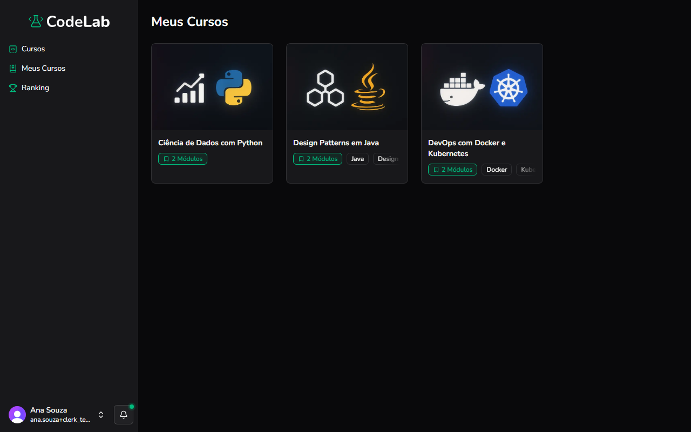

Objetivo: ver todos os cursos que você já comprou.

1. No menu à esquerda, clique em **Meus Cursos**.
Resultado: os cursos comprados aparecem em cards, com o título, o número de módulos e as tags.
2. Clique em um card para continuar assistindo de onde parou.
Resultado: você é levado para a próxima aula não concluída desse curso.

Você concluiu: você está vendo todos os seus cursos.

