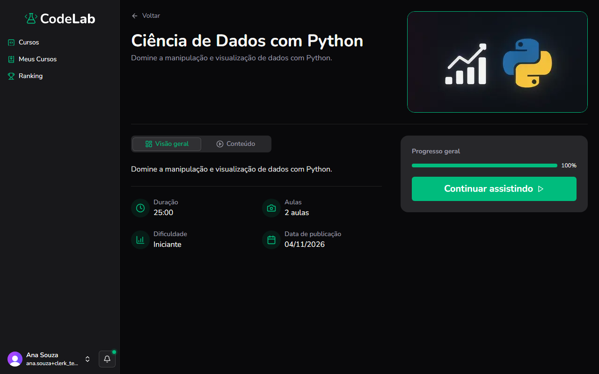
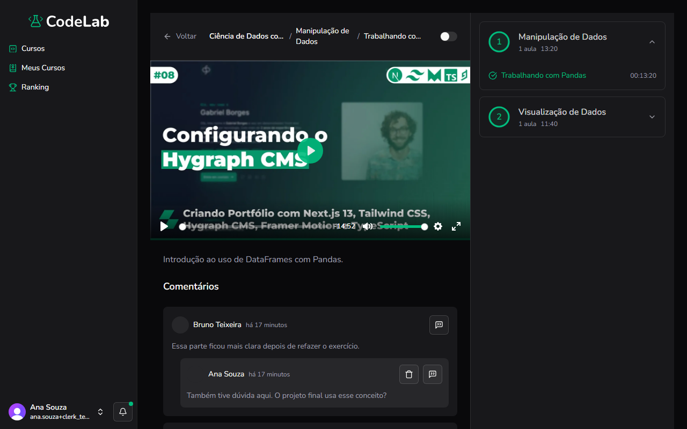

Objetivo: assistir às aulas de um curso comprado e acompanhar seu progresso.

1. No menu à esquerda, clique em **Meus Cursos** e depois no card do curso desejado.
Resultado: a página de detalhes do curso aparece, com a barra de **Progresso geral** e o botão **Continuar assistindo** (ou **Começar agora**, na primeira vez).

2. Clique em **Continuar assistindo**.
Resultado: você é levado para a próxima aula não concluída.
3. Use os controles do player, na parte de baixo do vídeo, para tocar, pausar, ajustar o volume e a velocidade.
Resultado: o vídeo toca, pausa ou muda de velocidade, conforme a opção escolhida.
4. No painel à direita, clique em um módulo para abrir ou fechar a lista de aulas dele.
Resultado: a lista de aulas daquele módulo aparece ou se esconde.
5. Assista a aula até o fim.
Resultado: o CodeLab marca a aula como concluída e, se a reprodução automática estiver ativada, passa para a próxima aula.

> [!NOTE]
> No celular ou no tablet, toque no vídeo para mostrar os controles, em vez de passar o mouse sobre ele.

Você concluiu: seu progresso no curso é atualizado.

