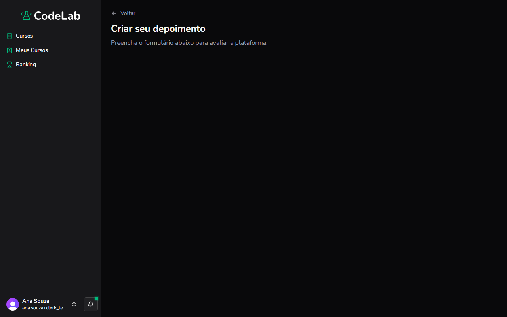

Objetivo: acessar a página para enviar um depoimento sobre sua experiência no CodeLab.

1. No canto inferior esquerdo, clique no seu nome e foto.
Resultado: o menu de conta se abre.
2. Clique em **Gostou da plataforma?**.
Resultado: a página **Criar seu depoimento** aparece, com instruções para avaliar a plataforma.

Você concluiu: você acessou a página de depoimentos.

