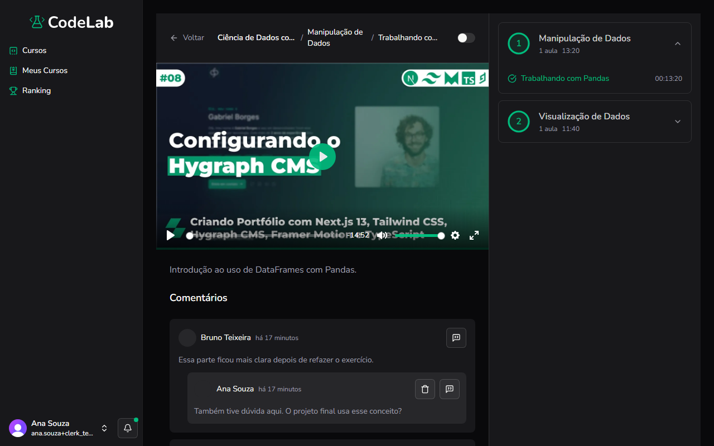

Objetivo: tirar dúvidas ou comentar sobre uma aula.

1. Na página da aula, role até **Comentários**.
Resultado: a seção de comentários aparece, com os comentários já feitos e o campo para comentar.
2. Digite seu comentário no campo **Deixe seu comentário** e clique em **Comentar**.
Resultado: seu comentário aparece na lista, com seu nome e foto.
3. Para responder a um comentário, clique no ícone de balão de fala ao lado do comentário.
Resultado: um campo de resposta se abre abaixo do comentário.
4. Para apagar um comentário seu, clique no ícone de lixeira ao lado dele.
Resultado: o comentário é removido da lista.

> [!NOTE]
> Você só consegue apagar os próprios comentários.

Você concluiu: seu comentário ou resposta foi publicado.

