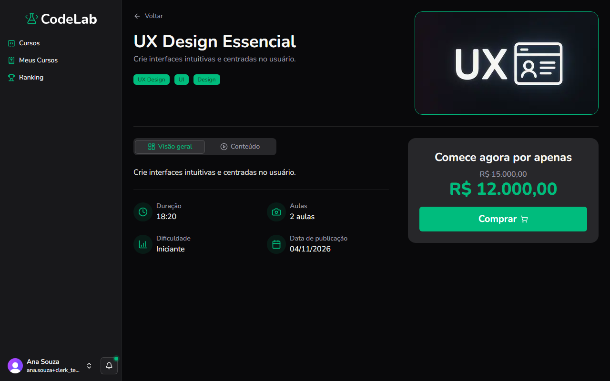

Objetivo: comprar um curso para ter acesso às aulas.

1. Na página de detalhes do curso, clique em **Comprar**.
Resultado: a janela **Concluir compra** se abre, com os métodos de pagamento **Pix** e **Cartão de crédito**.
2. Escolha o método de pagamento e clique em **Continuar**.
Resultado: se você ainda não entrou na plataforma, o CodeLab pede login ou cadastro antes de seguir.
3. No Pix, preencha **Nome completo**, **CPF**, **CEP** e **Número da residência** e clique em **Continuar**.
Resultado: um QR Code aparece, com um campo para copiar o código.
4. Escaneie o QR Code pelo aplicativo do seu banco ou clique em **Copiar** para colar o código manualmente.
Resultado: o código é copiado para a área de transferência.
5. Depois de pagar, clique em **Confirmar pagamento**.
Resultado: o CodeLab confirma o pagamento e libera o curso.
6. No cartão de crédito, preencha os dados do cartão (**Nome impresso no cartão**, **Número do cartão**, **Validade**, **CVV** e **Parcelas**), os dados do titular (**CPF do títular**, **Telefone do títular com DDD**) e o endereço (**Endereço (Opcional**, **Número**, **CEP**).
Resultado: o cartão de exemplo na tela mostra os dados conforme você digita.
7. Clique em **Confirmar**.
Resultado: você vê a mensagem de pagamento efetuado com sucesso e é levado para o curso.

> [!WARNING]
> Se der errado: se o pagamento não for confirmado, revise os dados digitados e tente novamente. Se o problema continuar, entre em contato com o suporte do CodeLab.

Você concluiu: o curso aparece em **Meus Cursos** e você pode começar a assistir.

