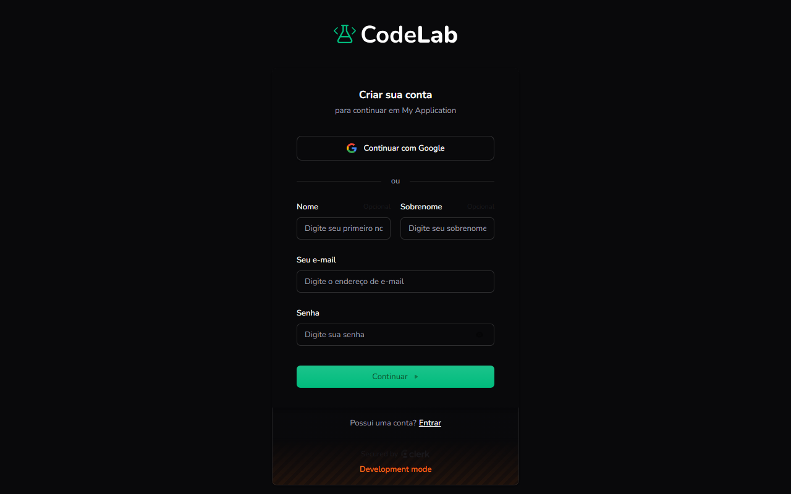

Objetivo: criar uma conta para acessar o CodeLab.

1. Na página inicial do CodeLab, clique em **Cadastre-se**, no canto superior direito.
Resultado: a tela **Criar sua conta** aparece.
2. Para entrar com sua conta do Google, clique em **Continuar com Google**.
Resultado: sua conta é criada e você já entra na plataforma, sem preencher os campos abaixo.
3. Para criar a conta com e-mail e senha, preencha **Nome**, **Sobrenome** (opcionais), **Seu e-mail** e **Senha**.
Resultado: os campos preenchidos ficam prontos para o próximo passo.
4. Clique em **Continuar**.
Resultado: sua conta é criada e você é levado para a plataforma.

> [!TIP]
> Já tem uma conta? Clique em **Entrar**, no rodapé da tela, para ir para a tela de login.

Você concluiu: sua conta está criada.

