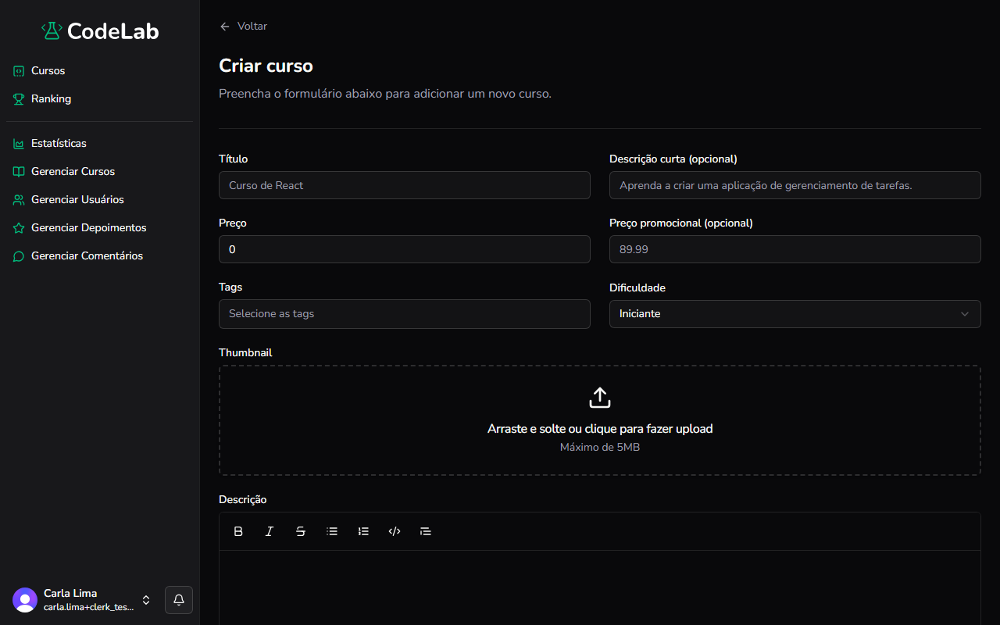

Objetivo: adicionar um novo curso à plataforma.

1. No menu à esquerda, clique em **Gerenciar Cursos**.
Resultado: a lista de cursos aparece.
2. Clique em **Adicionar curso**, no canto superior direito.
Resultado: o formulário **Criar curso** aparece.
3. Preencha **Título**, **Descrição curta** (opcional), **Preço** e **Preço promocional** (opcional).
Resultado: os valores aparecem nos campos preenchidos.
4. Em **Tags**, selecione as tags do curso ou digite uma nova para criá-la.
Resultado: a tag escolhida ou criada aparece selecionada.
5. Em **Dificuldade**, escolha **Iniciante**, **Intermediário** ou **Avançado**.
Resultado: a dificuldade escolhida aparece no campo.
6. Em **Thumbnail**, arraste uma imagem ou clique na área para fazer upload. O arquivo deve ter no máximo 5 MB.
Resultado: a imagem escolhida aparece na área de upload.
7. Preencha **Descrição** com o conteúdo completo do curso, usando a barra de formatação.
Resultado: o texto formatado aparece no campo.
8. Em **Módulos**, clique em **Adicionar Módulo**, preencha **Título** e a breve descrição do módulo e clique em **Adicionar**.
Resultado: o módulo aparece na lista de módulos do curso.
9. Dentro do módulo, clique em **Adicionar Aula**, preencha **Título**, **Descrição**, **ID do vídeo** e **Duração em Milissegundos** e clique em **Adicionar**.
Resultado: a aula aparece na lista do módulo.
10. Repita os passos 8 e 9 para todos os módulos e aulas do curso. Arraste pelo ícone de pontos à esquerda de cada módulo para reordená-lo.
Resultado: a ordem dos módulos no curso é atualizada.
11. Clique em **Criar curso**, no final da página.
Resultado: o curso é criado como rascunho e você volta para a lista de cursos.

> [!TIP]
> Um curso recém-criado fica com o status **Rascunho** e não aparece para os alunos até ser publicado.

> [!NOTE]
> No celular ou no tablet, toque e segure o ícone de pontos de um módulo para arrastá-lo, em vez de clicar e arrastar com o mouse.

Você concluiu: o novo curso foi criado.

