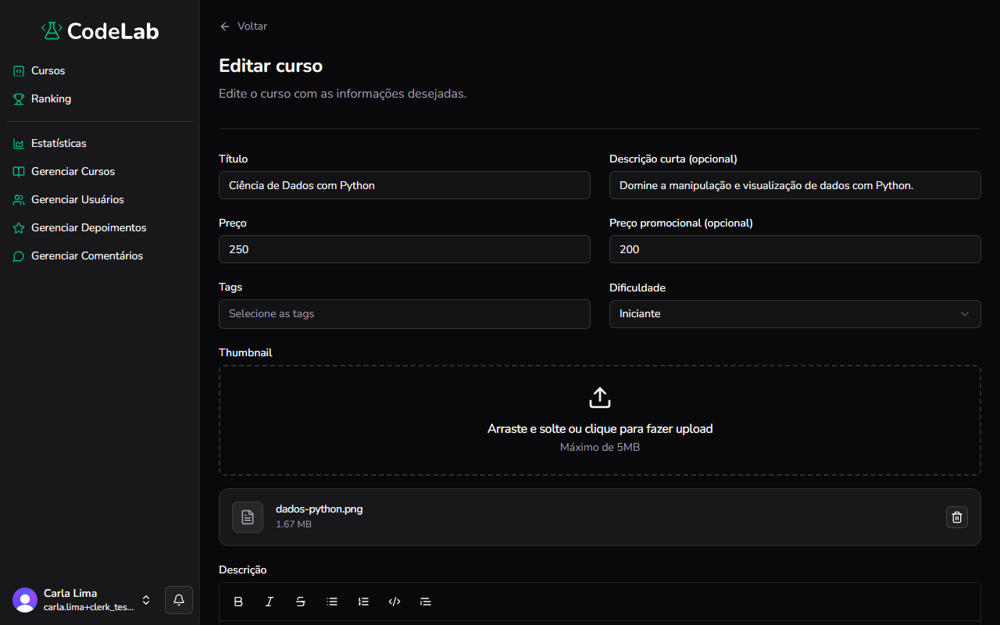

Objetivo: alterar as informações de um curso existente.

1. No menu à esquerda, clique em **Gerenciar Cursos**.
Resultado: a lista de cursos aparece.
2. Encontre o curso na lista ou pesquise pelo nome no campo **Pesquisar curso**.
Resultado: a lista mostra só os cursos que combinam com a busca.
3. Clique no ícone de lápis, na linha do curso.
Resultado: o formulário **Editar curso** aparece, preenchido com os dados atuais.
4. Altere os campos desejados, incluindo módulos e aulas.
Resultado: os campos alterados mostram os novos valores.
5. Clique em **Salvar alterações**.
Resultado: o curso é atualizado e você volta para a lista de cursos.

Você concluiu: o curso foi atualizado.

