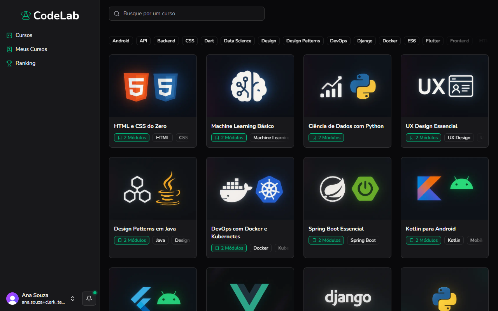

Objetivo: encontrar um curso na plataforma.

1. No menu à esquerda, clique em **Cursos**.
Resultado: a lista de cursos disponíveis aparece.
2. Para buscar por nome, digite no campo **Busque por um curso**, no topo da página.
Resultado: a lista mostra só os cursos que combinam com a busca.
3. Para filtrar por assunto, clique em uma das tags, como **Docker** ou **Design**.
Resultado: só os cursos com essa tag aparecem.
4. Clique no card de um curso.
Resultado: a página de detalhes do curso aparece, com a descrição, a duração, o número de aulas e a dificuldade.

Você concluiu: você encontrou e abriu um curso.

