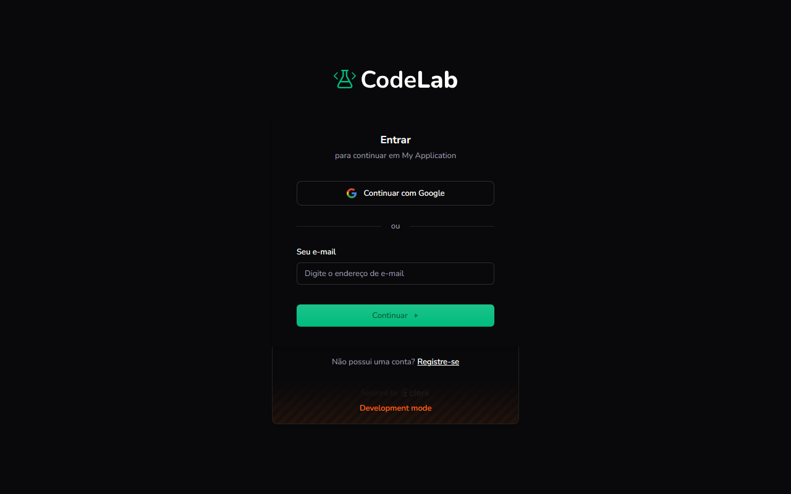

Objetivo: entrar na sua conta do CodeLab.

1. Na página inicial do CodeLab, clique em **Entrar**, no canto superior direito.
Resultado: a tela **Entrar** aparece.
2. Para entrar com sua conta do Google, clique em **Continuar com Google**.
Resultado: você entra direto na plataforma.
3. Para entrar com e-mail, digite seu e-mail em **Seu e-mail** e clique em **Continuar**.
Resultado: você é levado para a plataforma.

> [!WARNING]
> Se der errado: se você não conseguir entrar, siga as instruções de recuperação exibidas na própria tela de login.

Você concluiu: você está na plataforma.

