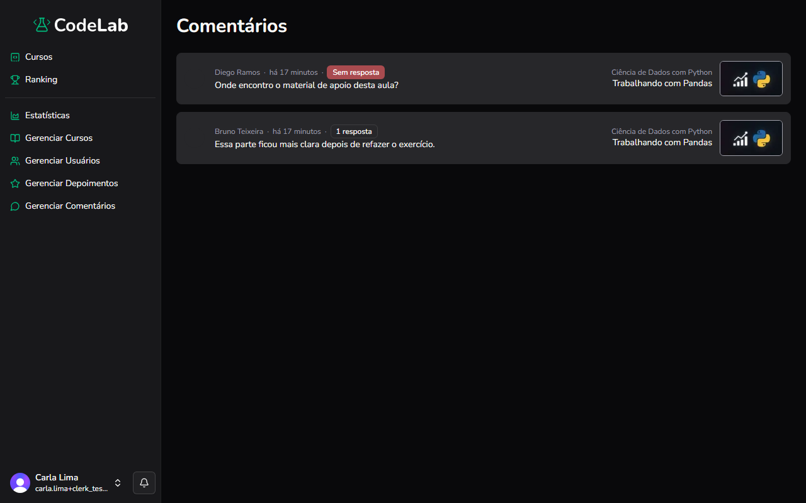

Objetivo: ver e responder aos comentários feitos pelos alunos nas aulas.

1. No menu à esquerda, clique em **Gerenciar Comentários**.
Resultado: a lista de comentários aparece, com o nome de quem comentou, o curso, a aula e se o comentário já tem resposta.
2. Clique em um comentário da lista.
Resultado: você é levado para a aula correspondente, com os comentários da aula visíveis.
3. Para responder, clique no ícone de balão de fala ao lado do comentário e digite sua resposta no campo que aparece.
Resultado: sua resposta aparece abaixo do comentário.
4. Para excluir um comentário, clique no ícone de lixeira ao lado dele.
Resultado: o comentário é removido.

Você concluiu: você moderou os comentários das aulas. Para outras dúvidas sobre a administração da plataforma, retome este manual pelo menu lateral ou procure o suporte do CodeLab.

