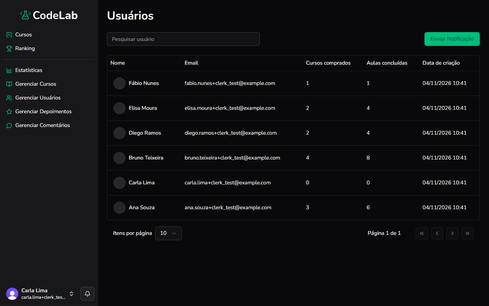

Objetivo: consultar os usuários da plataforma e enviar notificações.

1. No menu à esquerda, clique em **Gerenciar Usuários**.
Resultado: a lista de usuários aparece, com nome, e-mail, cursos comprados, aulas concluídas e data de criação.
2. Para encontrar um usuário, digite o nome ou o e-mail no campo **Pesquisar usuário**.
Resultado: a lista mostra só os usuários que combinam com a busca.
3. Para enviar uma notificação para todos os usuários, clique em **Enviar Notificação**.
Resultado: a janela **Enviar Notificação** se abre.
4. Preencha **Título**, **Conteúdo** e, se quiser, um **Link**.
Resultado: os campos preenchidos ficam prontos para o envio.
5. Clique em **Enviar**.
Resultado: a notificação é enviada para todos os usuários da plataforma.

> [!WARNING]
> Se der errado: a notificação é enviada para todos os usuários de uma vez e não pode ser cancelada depois do envio. Revise o texto antes de clicar em **Enviar**.

Você concluiu: você consultou os usuários ou enviou uma notificação.

