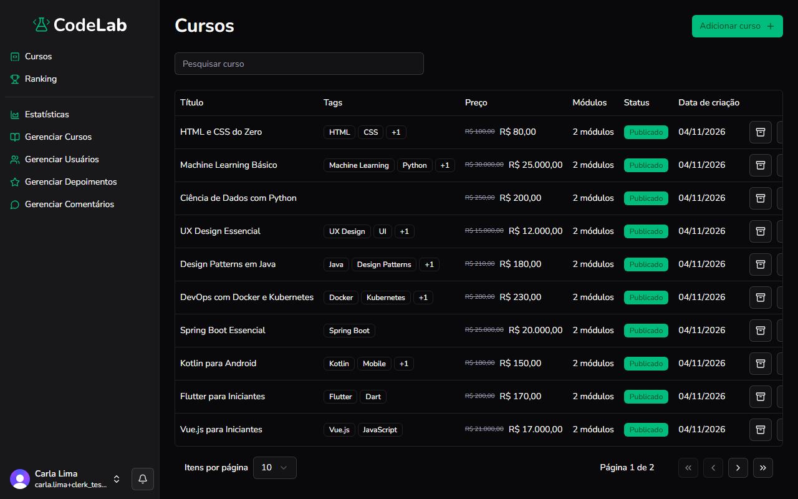

Objetivo: alterar o status de um curso ou removê-lo da plataforma.

1. No menu à esquerda, clique em **Gerenciar Cursos**.
Resultado: a lista de cursos aparece, com a coluna **Status**.
2. Na linha do curso, clique no ícone de envio para publicar um curso em rascunho, ou no ícone de arquivo para voltar um curso publicado para rascunho.
Resultado: o status do curso, na coluna **Status**, muda entre **Publicado** e **Rascunho**.
3. Para excluir um curso, clique no ícone de lixeira, na linha do curso.
Resultado: uma confirmação aparece, avisando que a ação não pode ser revertida.
4. Confirme a exclusão.
Resultado: o curso é removido da lista.

> [!WARNING]
> Se der errado: excluir um curso não pode ser desfeito. Essa ação também remove os módulos e as aulas dele. Confirme com cuidado antes de excluir.

Você concluiu: o status do curso foi alterado ou o curso foi excluído.

